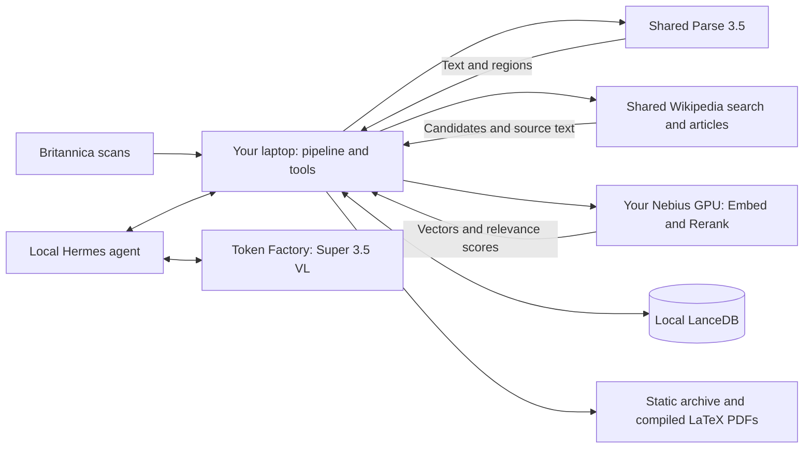

# Where the baseline runs

Your laptop is the CPU workspace in the organizer's diagram. You can move it to a CPU VM if the team needs one shared machine that stays online. Neither option needs a local GPU: the workspace calls model services over HTTP.

| Component | Where it runs | What it does |
| --- | --- | --- |
| Britannica scans | Downloaded from Hugging Face to your workspace | Original source images, with fixed row IDs and SHA-256 hashes |
| Parse 3.5 | Shared organizer service | Turns a scan into extracted text, layout classes and region coordinates |
| Wikipedia API | Shared organizer service | Finds candidate articles by words and returns article text with revisions and checksums |
| Embed VL | Your team's Nebius GPU VM | Converts text or a page image into a 2,048-number vector for similarity search |
| Rerank VL | The same GPU VM, same container | Reads a query with candidate passages and scores their relevance |
| LanceDB | Your CPU workspace, on disk | Stores your selected evidence vectors; retrieves passages by similarity |
| Hermes | Your CPU workspace | Runs the question loop, executes our tools, and sends evidence to Super VL |
| Super 3.5 VL | Nebius Token Factory | Plans searches and reasons about differences; Hermes uses it to answer questions |
| Archive and LaTeX | Your CPU workspace | Exports original scans, extracted regions, editable TeX and compiled PDFs |

The shared Wikipedia index searches millions of articles. Your LanceDB holds the evidence your team has selected and embedded. They have different jobs.

## Preparing the 100 pages

1. Select and retain 100 scans, including pages that fail later stages.
2. Send each scan to Parse. Save its raw output separately from derived text and regions.
3. Generate search phrases from each page. Query the shared Wikipedia service for candidate articles. Interleave candidates across phrases so one topic does not consume the whole budget.
4. Fetch and checksum the candidate article text. Split it into passages. Embed those passages and historical evidence with Embed VL, then store vectors in LanceDB.
5. Retrieve promising passages and pass them to Rerank VL. Its scores choose which evidence reaches the comparison model. A relevance score does not prove a factual agreement.
6. Use Super VL to compare the retained evidence. Record exact quotes and separate language changes, knowledge changes, coverage differences and uncertainty.
7. Compile escaped extracted text into LaTeX PDFs and export the static archive. Compilation checks document generation; people still need to review transcription accuracy.

## Answering a question

Hermes sends the question to Super VL. The model can request `search_sources`, `read_source` or `compare_page`. Hermes executes that tool on the workspace, returns its evidence to the model, and repeats until there is an answer. We save that conversation and its tool trace.

Hermes is the program coordinating the model and tools. It does not load the large Super model onto your laptop. GPU inference is needed for the models; file handling, HTTP calls, vector storage and LaTeX compilation fit on the CPU workspace.

## What is required to finish the live path

The organizer already provides Parse and Wikipedia. We still need the team's running GPU retrieval service URL and a Token Factory key in the local `.env`. Cloud CLI login manages cloud resources; it does not provide the separate Token Factory key.

Keep the GPU service on a private interface or use an SSH port forward. The official recipe binds port8000 to loopback. `RETRIEVAL_BASE_URL=http://127.0.0.1:8000/v1` then reaches the forwarded service from your laptop.
